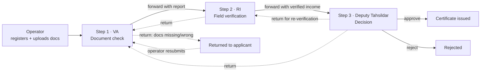

# Kadata · ಕಡತ

**An income certificate workflow tool for Nadakacheri (hobli revenue office) officers in Karnataka. It works in Kannada, English, Hindi, Telugu and Tamil.**

*Kadata* (ಕಡತ) is the Kannada word for "file". Officers already call every application a kadata, so the tool is named after the thing they handle all day.

| | |
|---|---|
| **Live app** | `<add Vercel URL>` |
| **API** | `<add Render URL>/api/health` |
| **Demo logins** | `operator`, `va`, `ri` and `dt`. The password for all four is `Demo@123`. You can also tap a role on the login screen to fill it in. |

> All names, documents and numbers are fictional. Sample documents and certificates are watermarked **SAMPLE / SPECIMEN – DEMO ONLY**.

---

## 1. The problem and who it affects

An **income certificate** (ಆದಾಯ ಪ್ರಮಾಣ ಪತ್ರ) is one of the most requested documents in rural Karnataka. Families need one for:
- post-matric scholarships and fee reimbursement
- reservation benefits
- housing schemes and widow pensions
- crop loans

For many families it decides whether a child can continue studying.

On the ground, every application passes through four desks at the Nadakacheri:

1. **Front-desk operator** (Atalji Janasnehi Kendra). Takes the paper form and documents and registers the application.
2. **Village Administrative Officer (VA / ಗ್ರಾಮ ಆಡಳಿತ ಅಧಿಕಾರಿ)**. Checks the documents against the form.
3. **Revenue Inspector (RI / ಕಂದಾಯ ನಿರೀಕ್ಷಕರು)**. Verifies the income in the village: land, occupation, neighbours, assets.
4. **Deputy Tahsildar (DT / ಉಪ ತಹಶೀಲ್ದಾರ್)**. Decides, and signs the certificate.

The service has a fixed time limit under the **Karnataka Sakala Services Act**. Officers pay a penalty for delays, and citizens can claim compensation.

**Where it breaks down today:**

| Pain | Who feels it |
|---|---|
| The VA cross-checks names, addresses and incomes across 3–5 documents by eye, often in a mix of Kannada and English, and misses mismatches. A salary slip showing 3× the declared income is only caught at the DT stage, or never. | VA, DT, honest applicants |
| The RI's field notes are informal (in Kannada, half-sentences, on paper). Turning them into a report takes time and loses detail. | RI |
| The DT reads the whole file cold, with reports in different languages, to make a decision that will be recorded under their name. | DT |
| Nobody can see which files are about to breach the Sakala limit, so files that came back for correction sit at the bottom of the pile. | All officers, the citizen |
| No one can tell where a file got stuck, or why it was returned. | Supervisors, the citizen |

**Who it affects:** field and office-level revenue staff who handle dozens of files a day, often on a phone in the field. Behind them are the families waiting on a certificate for a deadline-bound scholarship or scheme.

---

## 2. What the app does



**A worker can:**

- **See what needs attention first.** Each officer opens to *their own queue*. Files are ranked by a simple, explainable score:
  - files past the Sakala deadline come first, then those due within 5 days
  - files that came back after a return, or where the AI found issues, get a boost
  - so do files idle at the desk for 3+ days

  Every row says *why* it is urgent (badges such as "Overdue 2d", "Came back", "Income mismatch").
- **Move the file through 3 steps** (VA → RI → DT). The workflow engine enforces who can act at which stage. For example, an RI cannot touch a file sitting with the VA, and only the DT can approve or reject. Forwarding requires a report. Returning or rejecting requires a written reason. Double-submits are blocked.
- **Get AI help at each step.** See §3.
- **Approve, reject or return**, always as the officer's own decision:
  - The decision is never pre-selected.
  - A reason is mandatory.
  - A confirmation dialog says the decision is recorded in their name.
  - The DT can return a file to either the RI or the VA.
- **See the full history.** An append-only audit trail records:
  - who did what, when, and with what comment
  - every AI assist that was used
  - whether the final decision **agreed with or differed from** the AI suggestion
- **Register new applications** (operator), uploading scans or phone photos. **Resubmit returned files** once the missing documents are collected.
- **Print the certificate** in the chosen language.
- **See the impact metrics** on the Impact page (§4).

**Built for field workers:**
- **Kannada first.** The full interface is in ಕನ್ನಡ, English, हिन्दी, తెలుగు and தமிழ், switchable at any time and remembered on the device. Noto Indic fonts are used, with extra line-height for Indic scripts.
- **AI writes back in the officer's language.** A VA can work in Kannada and a DT in English on the same file.
- **Mobile-first.**
  - The bottom navigation sits under the thumb.
  - Touch targets are at least 44px.
  - Officers can take photos straight from the camera for field evidence.
  - Search waits until typing stops, and document uploads go one at a time, to cope with weak 3G.
- **Voice dictation** for field notes: Kannada, Hindi, Telugu, Tamil or English, via the browser's speech recognition. It is often faster than typing Kannada on a phone.
- **AI is optional.** If Gemini is down or rate-limited, each AI box shows "AI not available, you can continue without it", and the workflow continues normally.

---

## 3. Where AI helps, and why

The rule: **AI reads, compares, summarises and drafts. It never decides.** Every AI output sits in a clearly labelled purple box marked "AI can make mistakes. Check it — the decision is yours." Officers can re-run it, use it, edit it or mark it "Not useful".

| Step | AI assist | Why it genuinely helps here | Why not more |
|---|---|---|---|
| **1 · VA: document check** | Gemini reads every uploaded PDF or photo (multimodal), extracts name, father/husband name, address, income and ration-card type, and **cross-checks them against the form**:<br/>- name across Kannada and English transliterations<br/>- salary × 12 vs declared income<br/>- BPL card vs a high declared income<br/>- land on the RTC vs agricultural income<br/>It returns a checklist (Matches / Mismatch / Missing / Unclear), flags, and draft remarks. | Cross-reading 3–5 bilingual documents is the slowest, most error-prone part of the VA's day, and mismatches caught here save a full RI visit. | **Missing required documents are found by rules, not AI.** A missing RTC is a fact, not an opinion. The AI never marks a document as verified; the VA ticks their own checklist. |
| **2 · RI: field visit** | **(a)** A case-specific *field checklist* (what to verify, what to ask neighbours, what to see), built from that file's flags.<br/>**(b)** *Rough notes → formal report*: the RI types or **speaks** notes in any language, and the AI produces a formal report, an income breakdown, a suggested verified income, and what is still missing. | RIs do the visit well but write reports badly at the end of a long day. The checklist makes visits targeted. | The AI is told to use **only facts in the notes**. If the notes don't support an income figure, it leaves it blank and lists what is missing. The RI enters the verified income and recommendation themselves. |
| **3 · DT: decision brief** | Reads the whole file, including officer reports in *any* language, and produces a summary, an **income comparison table** (declared / documents / VA / RI), risks, a suggested decision with confidence and rationale, and **draft order remarks**. | The DT signs dozens of these a day. A one-screen brief in their language turns 10 minutes of reading into 1, and the risks list points at what to double-check. | The suggestion is shown but **the decision buttons are never pre-filled**. When the DT decides, we record whether it matched the AI. Disagreement is visible in the history and on the Impact page. |

**Where AI is deliberately *not* used:**
- prioritisation (a transparent formula officers can understand)
- workflow rules
- required-document checks
- the decision itself

**Privacy:**
- Only the last 4 digits of Aadhaar are stored.
- The applicant's mobile number and Aadhaar digits are never sent to the model.
- Documents stay in a private bucket and are streamed only to logged-in officers.

---

## 4. How we would measure impact, and why it should work

Every action and every AI call is logged, so the measurement is built in. The **Impact** page shows these numbers live.

| Goal | Metric | Where it comes from |
|---|---|---|
| Citizens served faster | **Average days to decision**; **average days at each desk** (VA / RI / DT) | Audit trail timestamps |
| Fewer Sakala breaches | **% decided within the Sakala limit**; overdue count | `decidedAt` vs `dueAt` |
| Fewer wasted round-trips | **% of files returned at least once** | `returnCount` |
| AI is genuinely useful | **% of AI suggestions used** (as-is or edited) vs marked "Not useful"; per-step breakdown | `AiRun.feedback`, set automatically when the officer uses or ignores a suggestion, or explicitly via "Not useful" |
| Officers stay in control | **% of DT decisions that matched the AI brief** | `agreedWithAi` on each decision event |
| AI is fast enough for the field | Average AI latency per step | `AiRun.latencyMs` |

**How I would run it:** pilot in 2 Nadakacheris (one using Kadata, one comparable control) for 6–8 weeks, with a 2-week baseline taken from the existing register. Success would look like:
- **≥30% lower median days-to-decision**
- **Sakala compliance above 95%**
- **fewer returns from the DT stage**, because mismatches are caught at the VA stage
- an **"AI used" rate above 60% with a falling "not useful" rate**, which is the signal that the prompts are improving
- a **DT–AI agreement rate that is high but not 100%**. A perfect 100% would suggest rubber-stamping, so it is the number to watch.

Pair this with a 5-question survey of officers and a sample audit of 20 approved files per month for decision quality.

**Why I think it will work:**
1. It **mirrors the existing desks and responsibilities** instead of inventing a new process. Officers keep their roles and their signature authority.
2. It **removes the slowest manual steps** (cross-reading documents, writing reports, reading cold files) without removing judgment.
3. The **deadline-first queue** directly targets the metric officers are penalised on (Sakala).
4. **Kannada-first, mobile and voice** match how field staff actually work.
5. It **degrades gracefully**: no AI, no problem.

---

## 5. Main technical decisions

| Area | Choice | Why |
|---|---|---|
| Frontend | **React 19 + Vite + TypeScript + Tailwind v4** | Fast to build and small to ship; Tailwind keeps the design consistent across 5 scripts. |
| API calls | **Axios** (single instance with interceptors) + **TanStack Query** | One place for the JWT header, auto-logout on 401, and readable error messages; Query handles caching and refresh after each action. |
| i18n | **react-i18next**, typed locale files (`en.ts` is the source; TS fails the build if a language is missing a key) | Five complete languages without drift. Adding Marathi is one file. |
| Backend | **Node + Express + TypeScript**, modular (`auth`, `applications`, `workflow`, `documents`, `ai`, `insights`) | Small, readable, easy to host. |
| Validation | **Zod** on env and every request body | Bad input fails early with field-level messages. |
| Workflow | A **pure-function engine** (`server/src/modules/workflow/engine.ts`) holding the transition table, the role-per-stage map and the priority score, **unit-tested with Vitest** | The rules a reviewer most needs to trust live in one 150-line file with tests, not scattered across routes. |
| Consistency | Each action runs in a **DB transaction** using an `updateMany ... where stage = current` guard | Two officers or a double click cannot move a file twice (returns 409). |
| Database | **PostgreSQL (Neon) + Prisma** | Relational data with a strict audit trail; Prisma gives typed queries. |
| Audit | An **append-only `AuditEvent` table** plus `StageReport` and `AiRun` tables | History, accountability and impact metrics all come from the same data. |
| AI | **Gemini 2.5 Flash** via `@google/genai`, using **structured JSON output with response schemas**, temperature 0.2, PDFs and photos sent inline | Multimodal (reads scans directly), cheap, fast, and the schema means the UI never parses free text. Model is configurable with `GEMINI_MODEL`. |
| Auth | **JWT** (bcrypt-hashed passwords, 12h expiry, login rate-limited) and role checks on every route | Stateless and simple to deploy. |
| Documents | **Cloudflare R2** (private bucket, S3 API), with automatic **fallback to PostgreSQL** when R2 isn't configured | Files are never public; they are streamed through the authenticated API. The fallback means the app runs with zero extra setup. |
| Hosting | **Vercel** (frontend) and **Render** (API), with **Neon** (DB) | Free tiers, Git-based deploys. |

**Known limitations / next steps:**
- **Offline drafts** for RIs in no-signal villages (a service worker plus a queued sync).
- An **SMS to the citizen** when a file is returned or approved.
- A **supervisor (Tahsildar) view** across hoblis.
- **Integration with Bhoomi (RTC) and the ration-card database**, instead of relying on uploaded copies.
- **A Sakala time limit to confirm.** Public sources disagree on the limit for this certificate (7 to 21 days quoted), so it is configurable via `SLA_DAYS`. The demo uses 21.
- **Seeded history.** The demo data includes synthetic history for already-decided files so the Impact page has numbers on day one. Live AI runs are recorded the same way.

---

## 6. Run it locally

**Requirements:** Node 20+ and a PostgreSQL database. A free [Neon](https://neon.tech) database works, or a local Postgres.

```bash
# 1. API
cd server
cp .env.example .env        # fill in DATABASE_URL, DIRECT_URL, JWT_SECRET, GEMINI_API_KEY (R2 optional)
npm install
npm run db:push             # create tables
npm run db:seed             # 4 officers + 22 sample applications with generated PDFs
npm run dev                 # http://localhost:5050

# 2. Web app (new terminal)
cd client
npm install
npm run dev                 # http://localhost:5173 (proxies /api to :5050)
```

Log in as `va` / `Demo@123` and open the top file in the queue. Then try the same file as `ri` and `dt`.

**Tests:** `cd server && npm test` runs the workflow rules and priority scoring.

**Useful scripts:**

| Command | What it does |
|---|---|
| `npm run db:reset` (server) | Wipe and reseed the demo data |
| `npm run typecheck` (both) | TypeScript checks |
| `npm run build` (both) | Production builds |

### Environment variables (server)

| Variable | Required | Notes |
|---|---|---|
| `DATABASE_URL` | ✅ | Pooled connection string (Neon: add `pgbouncer=true`) |
| `DIRECT_URL` | ✅ | Direct (non-pooled) connection string, used by `prisma db push` |
| `JWT_SECRET` | ✅ | Long random string |
| `GEMINI_API_KEY` | for AI | From https://aistudio.google.com/app/apikey. Without it the app works and AI boxes say "not available". |
| `GEMINI_MODEL` | | Default `gemini-2.5-flash` |
| `R2_ACCOUNT_ID`, `R2_ACCESS_KEY_ID`, `R2_SECRET_ACCESS_KEY`, `R2_BUCKET` | | If all are set, documents go to R2; otherwise they are stored in PostgreSQL |
| `CORS_ORIGIN` | | Comma-separated frontend URLs |
| `SLA_DAYS` | | Sakala time limit in days (default 21) |

Frontend: `VITE_API_URL` is the API origin in production (e.g. `https://kadata-api.onrender.com`). Leave it empty locally.

### Project structure

```
server/
  prisma/schema.prisma        data model (applications, documents, reports, audit, AI runs)
  prisma/seed.ts              demo officers + 22 applications with generated sample PDFs
  src/modules/workflow/       transition rules + priority score (+ tests)
  src/modules/applications/   queue, detail, create, actions
  src/modules/documents/      upload/stream, R2 or Postgres storage
  src/modules/ai/             Gemini client, prompts + JSON schemas, the 4 assists
  src/modules/insights/       impact metrics
client/
  src/api/                    axios client, types, React Query hooks
  src/i18n/locales/           kn · en · hi · te · ta
  src/components/stages/      VA, RI, DT and operator work panels
  src/pages/                  queue, all files, application, new, impact, certificate
```
